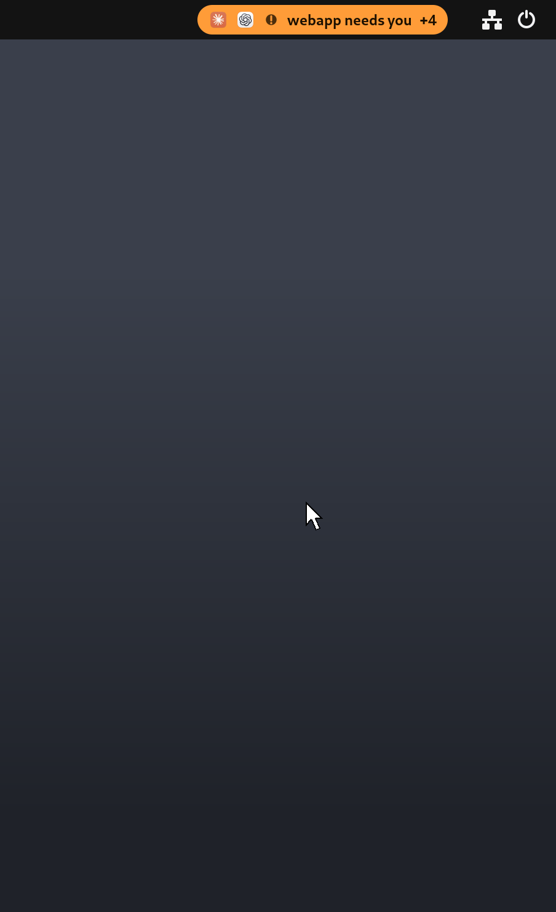

<div align="center">

#  Agentail

**The AI coding agent status island for Linux.**

Claude Code and Codex — on your desktop and on every SSH server — in the GNOME top bar,
with your subscription limits one click away.

English · [简体中文](README.zh-CN.md)

[](https://github.com/YeTianwei/Agentail/releases)
[](LICENSE)




</div>

## 💡 What is Agentail?

You start Claude Code in one terminal, Codex in another, and two more on the GPU server. Then you
switch to something else, and the agent that has been waiting ten minutes for your permission is
the one you never look at.

Most tools that watch coding agents live in the macOS notch. **Agentail is made for the Linux
desktop**, and for the servers you SSH into, where the long runs actually happen. A small capsule
in the GNOME top bar shows what every agent is doing. When one of them needs you, it turns orange
and names the project. Click it to see a card for each session with the machine, the project and
what the agent is doing. For a permission prompt, the card shows the command it wants to run.
Turn on [approvals](#-approvals) and you answer Yes or No right there; otherwise you answer in the
agent's own terminal, as always.

## ✨ Highlights

- 🐧 **Linux first.** A native GNOME Shell extension and a `.deb`, not a port of a Mac app.
- 🌐 **Your servers are first class.** Sessions on remote machines reach your desktop through an
  `ssh -R` tunnel. Add a server from the panel in two clicks. Nothing runs on it but one small
  hook script.
- 📦 **Install and forget.** `apt install`, log in again, done. The hooks, the daemon and the panel
  set themselves up.
- 🛡️ **Never in the agent's way.** The hook sends one message and exits. If your desktop is not
  listening, it returns at once, prints nothing, and never blocks or fails a tool call.
- 📊 **Usage limits at a glance.** Claude Code's 5-hour and weekly limits and Codex's, with when
  each one resets. Your Claude login is used only if you say yes.
- ✅ **Answer permission prompts from the panel.** Yes or No on the card, with the whole command
  in front of you. Off until you turn it on; whenever the panel cannot answer, the agent asks in
  its terminal as before.
- 🧮 **Token counts.** How many tokens your agents used today, in the last 7 or 30 days and over
  their lifetime, by agent, model, host or project, here and on your servers, with a chart.
- 🔒 **Local and private.** Your machines talk to your desktop over SSH and Unix sockets. No
  account, no cloud, no telemetry. Agentail contacts no online service on its own. The one
  exception is the Claude usage query, and only if you turn it on (Codex asks for its own limits).
- 🌗 **Light and dark.** One click, top right of the panel.
- 🌐 **English and Chinese.** The panel and its notifications follow your desktop's language. You
  can pick another one in the panel's settings.
- 🆓 **Open source.** MIT licensed, written from scratch.

## 👀 At a glance

| The capsule shows | Meaning |
|---|---|
| ⚪ a small dot | nothing is running |
| 🔵 agent logos + a spinner and a number | that many sessions are working |
| 🟢 a green dot and a number | that many sessions are waiting for your next prompt |
| 🟠 orange, "*project* needs you" | an agent is asking for permission |
| 🔴 a red dot in the corner | a server is unreachable |

You also get a desktop notification when a turn finishes or an agent asks for permission. It
names the project and the machine only, not your prompt or the command (see
[Configuration](#-configuration)).

## 📊 Usage limits

The panel's **Usage** section shows how much of your subscription is left. Each agent has a card
with a bar for each window (5 hours, week), the percentage used and when it resets. The bar turns
orange from 70 % and red from 90 %. If you don't need it, turn off "Show usage limits" in the
panel's settings (the gear, top right) or run `agentail usage off`. Agentail then collects no
usage at all.

| Agent | Where the numbers come from | When they refresh |
|---|---|---|
| Claude Code (Pro / Max) | the input Claude Code gives its status line in a terminal; if you turn it on, also Anthropic's usage endpoint, asked with Claude Code's login | whenever a terminal session answers; with the endpoint, also a few seconds after any Claude turn ends (at most once a minute) and when you open the panel |
| Codex | Codex itself (`codex app-server`), else its session files | when you open the panel (at most once a minute) |

**Claude and your login (off until you turn it on).** Claude Code only hands its limits to the
status line of an interactive terminal session. The VS Code extension and Claude Desktop never do.
Agentail can ask `api.anthropic.com` for them itself, the way Claude Code's `/usage` does, with the
access token of Claude Code's login in `~/.claude/.credentials.json`. It does so only after you
turn it on in the panel's settings (the gear next to the light/dark button, top right) or with
`agentail usage-api on`. You can switch it off there at any time. The token is read for each
request and sent only to that address. It is never refreshed, written anywhere or logged, and
nothing else from the file is used. An expired login waits until you next run `claude`.

The token lasts only a few hours (eight, in our tests), and only Claude Code running on this
computer renews the file, such as `claude` in a terminal. VS Code Remote runs Claude on the server,
so it renews the server's login and not this one. Claude Desktop keeps a login of its own. If you
rarely run `claude` here, the panel will often say "Sign-in expired: run claude once". In that
case, turn on the Servers switch below. Your servers' logins stay fresh while you use them.

Before you turn it on, know that Anthropic does not document this endpoint, that it may change, and
that the requests say they come from Agentail, not from Claude Code. How Anthropic treats such
requests from tools other than Claude Code is up to Anthropic.

**Servers** have a switch of their own, next to it in the settings (`agentail usage-api on
--servers` in a terminal). With it on, Agentail asks a server over ssh with the server's own login
whenever this computer's query cannot cover it. That happens when the server uses another Claude
account, or when this computer's switch is off or its login has expired. A short Python script runs
there, nothing is installed, and the token never leaves the server. `agentail usage-api off --all`
turns both off. `agentail doctor` shows how the query is doing. While this computer's switch is
off, the Usage section says so in one line.

Agentail also wraps your status line command so that terminal sessions on your servers report
too. The command still gets the same input and prints the same output, and uninstalling puts it
back. Agentail never reads `~/.codex/auth.json`.

A card that has not been updated for 30 minutes is greyed out. A window that has reset since then
shows no old percentage. Usage is per account, so if your servers use the same account as your
desktop, one card covers both.

## 🧮 Token counts

The bar chart button at the top right of the panel, next to the settings, opens the **Tokens**
page: how many tokens Claude Code and Codex used today, in the last 7 or 30 days, or over their
lifetime. On top is the total with four kinds that do not overlap (input, cache write, cache
read, output; thinking is part of the output), then a day's average, how it compares with the
same stretch of time before, and how many responses there were. A chart shows today hour by hour
or the last 7 or 30 days day by day; click a column to see that hour or day alone. Below, the
range is added up by agent, model, host or project. The total counts everything the agents read
and wrote the way Codex's own "lifetime tokens" does. Most of it is the conversation read back
from the cache on every turn, which is why cache read is by far the largest. There are no
prices: the numbers are tokens, not a bill.

`agentail tokens` shows the same numbers by day, week, conversation, model or server.

The numbers come from the agents' own session files (`~/.claude/projects`, `~/.codex/sessions`),
the same ones `claude --resume` uses. The daemon reads only what was added since its last look:
a few seconds after a turn ends, when you open the panel, and once a minute. A server is read
after a turn ends there and when you open the panel (at most once a minute), over ssh with a
short Python script. Nothing is installed there, and only numbers, ids, model names and the
project folder's name come back, never your prompts or code. Servers that share a `$HOME` are
read once; each session is counted on the server its hook events came from, or for Claude Code,
the server whose `/tmp` holds its session folder (the rest show under all of them, like
`gpu7·gpu8`).

The counts are kept in `~/.local/state/agentail/tokens.sqlite` for 400 days. That is longer than
the agents keep their own files (Claude Code removes them after 30 days by default), so after the
first month Agentail has history that is no longer anywhere else. The first start reads
everything that is still there.

```bash
agentail tokens                        # the last 7 days, by day
agentail tokens --by week --weeks 8
agentail tokens --by session --days 7  # the 20 largest conversations
agentail tokens --by model             # or --by host; --agent codex; --json
agentail tokens off                    # or `off --servers`; also in the panel's settings
agentail tokens forget                 # delete every count, start over from now
agentail tokens assign gpu8            # sessions of gpu8's shared $HOME with no known server: gpu8's
```

These are the numbers the agents wrote down, not a bill. Agentail does not turn them into money.

## ✅ Approvals

When Claude Code or Codex asks for permission, you can answer from the panel instead of finding
its terminal. Turn it on under Approvals in the panel's settings, or:

```bash
agentail approvals on
```

The session's card then shows the whole command, every line of it, the agent's reason, **Yes**
and **No**, and how long it still waits. Yes allows that one call; No denies it and tells the
agent so. The buttons only answer to a click: Enter never approves, and the panel never opens by
itself.

Nothing is ever approved for you. Whenever the panel cannot answer, the agent asks in its terminal
as it always did: the switch is off, the panel is not running, the screen is locked, nobody has
touched the desktop for 5 minutes, a server's tunnel is down, or nobody answers in time.

- **Claude Code** keeps its own prompt open meanwhile. Answer in either place.
- **Codex** shows its prompt only after the panel has waited, 30 seconds by default. Change it with
  `agentail approvals wait codex 20` (5 to 60).
- **Servers** answer through the same tunnel. After upgrading, run `agentail add-host <alias>`
  again for each server so its hooks wait for the answer.

Codex asks you to trust the changed hook entry once (`/hooks`), on this computer and on each
server.

## 🤖 Supported

| Agent | Status | What you see |
|---|---|---|
| Claude Code | ✅ | working, your turn, needs permission (with the command), ended; usage limits on Pro / Max |
| Codex CLI (0.155+) | ✅ | the same, and usage limits; trust the hooks once with `/hooks` |
| Qoder CLI and Qoder IDE (international and China editions) | ✅ from 0.0.3 (tested: CLI 1.1.68, IDE 1.1.66) | working, your turn, needs permission (with the command), ended; no usage limits |
| Qwen Code, Gemini CLI, Cursor, OpenCode, … | 🗓️ planned | |

| Where | Status |
|---|---|
| Ubuntu 24.04, GNOME 46 (X11 and Wayland) | ✅ tested |
| Other GNOME 45–49 desktops | 👍 should work (45, 47–49 checked against upstream sources only) |
| Other Linux desktops | AppIndicator fallback: `agentail ui` |
| Remote servers | any Linux with Python 3.6+ and key-based SSH |

## 🚀 Quick start

Download `agentail_<version>.deb` from
[Releases](https://github.com/YeTianwei/Agentail/releases), then:

```bash
sudo apt install ./agentail_0.0.7.deb
```

**Log out and back in once** (on X11, Alt+F2, `r`, Enter is enough) and the capsule appears.

Behind the scenes, the package starts the daemon. The daemon merges the hooks into
`~/.claude/settings.json`, `~/.codex/hooks.json` and `~/.qoder/settings.json` /
`~/.qoder-cn/settings.json` for the agents you have, backs each file up to
`~/.agentail/backups/` first, and enables the panel.

> **Codex** only runs hooks you trust. Start `codex` once and approve the `agentail-hook` entries
> (or use `/hooks`).

<details>
<summary>🛠️ From source (development)</summary>

```bash
git clone https://github.com/YeTianwei/Agentail && cd Agentail
python3 -m venv --system-site-packages .venv
.venv/bin/pip install -e '.[dev]'
export PATH="$PWD/.venv/bin:$PATH"

agentail install-local              # merge the hooks (add --dry-run to preview)
agentail install-service            # run the daemon with your desktop session
agentail install-gnome-extension    # the panel (--link for a symlink to the source)
```

Build the package with `packaging/build-deb.sh` (output in `dist/`). Do not mix a source install
with the package on one machine. A unit from `install-service` overrides the packaged one.

</details>

## 🌐 Add your servers

1. Open the panel's settings (the gear, top right) and find **Servers** at the bottom.
2. Click **＋ Add server** and pick a host from your `~/.ssh/config` (or type its name).
3. A few seconds later it shows as connected, and its sessions appear next to your local ones.

The settings list every server with its state. The main panel shows a server only while it
cannot be reached, with the reason. The capsule then has a red dot.

The server needs key-based login (`ssh <alias> true` works without a prompt) and Python 3.6+.

To remove one, click the trash can on its row in the settings. Agentail takes this desktop out of
the server's Claude and Codex settings, and puts them back exactly as they were once no desktop is
left in them. Their backups stay in the server's `~/.agentail/backups/` (readable only by you).
Delete that directory when you no longer need them. Removing needs the server reachable, also
when it shares its home with another server you keep. If it cannot be reached,
**Forget it anyway** just stops watching it and leaves the server as it is.

From a terminal:

```bash
agentail add-host gpu7 --dry-run    # probe the server and show the changes
agentail add-host gpu7
agentail remove-host gpu7
```

Agentail recognises servers that share one NFS home. The hook is installed once, each server's own
socket is removed when you remove that server, and the shared settings go back to the original
with the last of them. It works even when your uid differs between them. On each server, run
`codex` once to trust its hooks.

One server can be watched from several desktops, and a desktop can itself be a server for another
one. Each receiver gets its own socket, the hook sends every event to all of them, and removing
one leaves the others working. Codex asks you to approve the hooks again whenever a receiver is
added or removed on a machine.

> **Upgrading from 0.0.3 or earlier:** run `agentail add-host <alias>` once more for each server
> (from every desktop that watches it) to switch it to the new socket name. Then approve the
> changed hooks in `codex` on that server. Until then the old setup keeps working as before.

## ⚙️ How it works

```
 your server                                   your desktop
┌──────────────────────────┐                  ┌───────────────────────────────────────┐
│ claude / codex           │                  │ agentail daemon (systemd user unit)   │
│   └─ hook: agentail-hook ├─► Unix socket ──►│   one socket per machine              │
│        (one message,     │   via ssh -R     │   → per-agent adapter → session state │
│         never blocks)    │                  │   → ui.sock ──► GNOME Shell extension │
└──────────────────────────┘                  └───────────────────────────────────────┘
       this desktop's agents use the same hook, straight to a local socket
```

- 🪝 **Hook.** `agentail-hook.py` (standard library, Python 3.6+) reads the agent's hook payload
  and sends it, with a whitelist of terminal variables, to a Unix socket. On any problem it exits
  0 silently.
- 🚇 **Tunnel.** One `ssh -N -R` per server. It counts as connected only after an end-to-end ping,
  reconnects with backoff, and marks that server's sessions out of date while it is down.
- 🧠 **Daemon.** Which machine an event came from is decided by the socket it arrived on, never by
  its content. Sessions are kept across restarts. It runs under systemd without your shell's
  environment, so `agentail install-local` from a terminal tells it what your shell knows (see
  [Configuration](#-configuration)).
- 🖥️ **Panel.** A GNOME Shell extension that reads the daemon's `ui.sock`. Payload text (prompts,
  commands, paths) is untrusted. It is shown as plain text and never put into a shell command.

## 🔧 Configuration

Nothing is required. `~/.config/agentail/config.toml` can change:

```toml
[sessions]
stale_after_minutes = 30    # working, then silent: greyed out as "out of date"
forget_after_minutes = 120  # out of date or waiting for you, then silent: removed
ended_minutes = 10          # ended: removed
# Sessions started in (or below) these folders are not shown. Apps like CodexBar start
# `claude` by themselves to read its limits; [] shows everything.
ignore_cwd = ["~/.local/share/CodexBar"]

[setup]
auto = true                 # false: do not set up hooks and the panel automatically

[usage]
enabled = true              # false: no usage limits in Agentail at all (`agentail usage off`)
claude_api = false          # true: ask Anthropic for Claude's limits with this computer's login
claude_api_servers = false  # true: also with each server's own login, over ssh

[notifications]
turn_done = true            # false: no notification when it is your turn
attention = true            # false: none when an agent needs your approval
details = false             # true: put the prompt and the command into notifications

[approvals]
enabled = false             # true: answer permission prompts from the panel
[approvals.wait_s]
codex = 30                  # seconds before Codex asks in its terminal (5 to 60)

[tokens]
enabled = true              # false: read no session files, show no token counts
servers = true              # false: count only this computer's agents
keep_days = 400             # older responses are dropped (7 to 3650)
```

A session waiting for permission is never removed on a timer.

**Why notifications leave out the details.** GNOME shows notification banners on the lock screen
too, so anyone at your desk could read a prompt or a command, which may name a host, a path or a
token. By default a notification only says which project on which machine is done or needs you.
The panel, behind your login, still shows everything. Set `details = true` if your screen is
private.

`[usage]`, `[notifications]`, `[approvals]` and `[tokens]` apply within a few seconds. After changing `[sessions]` or
`[setup]`, restart the daemon with `systemctl --user restart agentail`.

## 🗄️ What Agentail keeps on disk

Everything stays on your machines. The only outside request is the usage query to Anthropic (see
[Usage limits](#-usage-limits)). Its state, settings and sockets live in
`~/.local/state/agentail`, `~/.config/agentail`, `~/.agentail` and `$XDG_RUNTIME_DIR/agentail`.
Files that can hold your prompts, commands or secrets are readable only by you.
[docs/files.md](docs/files.md) lists every file, what it holds and its permissions.

## 🩺 Troubleshooting

```bash
agentail doctor
```

checks the daemon, autostart, the hooks (whether the Python they run still exists, and whether
Codex trusts them), what the daemon knows of your shell, every server's tunnel and the panel, and
prints the command that fixes each problem.

| Command | What it does |
|---|---|
| `agentail status` | machines, usage limits and sessions in the terminal |
| `agentail tail` | live session changes |
| `agentail usage on\|off\|status` | usage limits in Agentail at all (on by default; also in the panel's settings) |
| `agentail notifications on\|off\|status [--turn-done\|--attention\|--details]` | desktop notifications: both kinds, one of them, or the prompt and command in them (also in the panel's settings) |
| `agentail approvals on\|off\|status` | answering permission prompts from the panel (off until turned on; also in the panel's settings); `approvals wait codex N` sets how long Codex waits for it |
| `agentail tokens [--by day\|week\|session\|model\|host]` | token counts in the terminal; `tokens on\|off\|status [--servers]` switches them (also in the panel's settings) |
| `agentail usage-api on\|off\|status [--servers\|--all]` | the Claude usage query with Claude Code's login, this computer's or the servers' switch (both off until turned on; also in the panel's settings) |
| `journalctl --user -u agentail` | daemon log |
| `agentail setup` | redo the automatic setup by hand |

After an upgrade, the panel tells you if GNOME Shell is still running the old version. Press
Alt+F2, `r`, Enter (X11) or log in again.

## 🧹 Uninstall

```bash
agentail remove-host gpu7      # for each server: restores its config files
agentail uninstall-local       # restores ~/.claude/settings.json and ~/.codex/hooks.json
                               # (other desktops' entries on this machine stay until they remove it)
sudo apt remove agentail
```

Run the first two before removing the package, while the `agentail` command is still there.
Hooks left behind are harmless. Without the daemon they do nothing.

Both keep the backups of your agent configs in `~/.agentail/backups/` (on each server too) as a
last way back, and say so. `~/.agentail` then stays. When you no longer need the backups, run
`rm -r ~/.agentail` (and the same on each server, unless another Agentail desktop uses it). The
session, usage and token files in `~/.local/state/agentail/` and your settings in
`~/.config/agentail/` can be removed the same way.

## 🗺️ Roadmap

What each release brought is in the [changelog](CHANGELOG.md). Next:

- **Later**: Qwen Code and Gemini CLI, then Cursor and plugin-based agents such as OpenCode.

## 📄 License

MIT. The Claude and OpenAI logos in the extension's `icons/` directory are trademarks of their
owners and are not covered by the MIT license (see `icons/NOTICE.md`).
