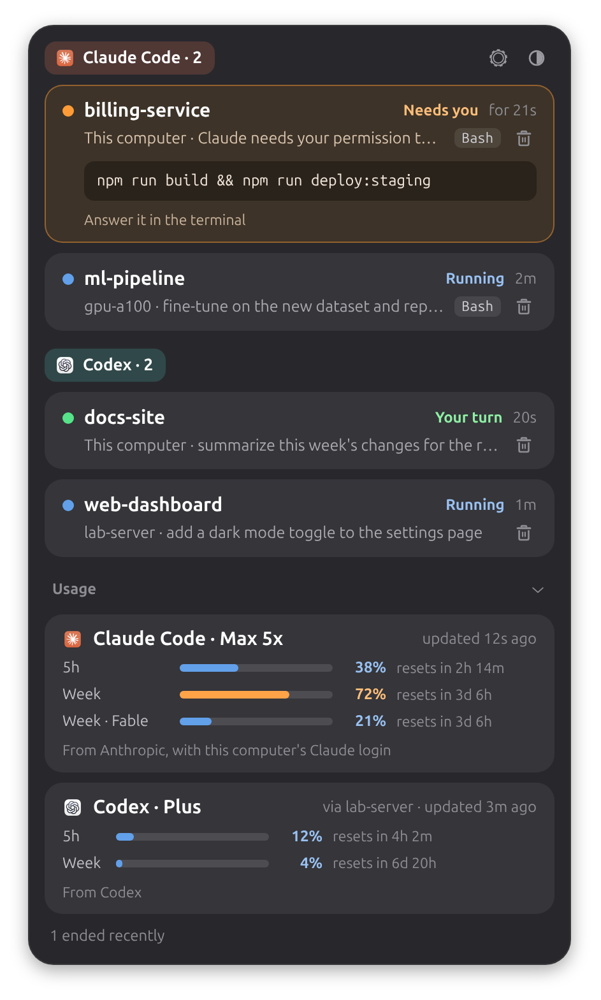

<div align="center">

#  Agentail

**Linux 上的 AI 编程 agent 状态灵动岛。**

本机和每台 SSH 服务器上的 Claude Code、Codex，都汇总在 GNOME 顶栏里，
订阅额度点一下就能看到。

[English](README.md) · 简体中文

[](https://github.com/YeTianwei/Agentail/releases)
[](LICENSE)




</div>

## 💡 Agentail 是什么？

一个终端里开着 Claude Code，另一个开着 Codex，GPU 服务器上还跑着两个。等你切去忙别的事，
偏偏是那个已经等你授权十分钟的 agent，你一直没顾上看。

盯 agent 的工具大多做在 macOS 的刘海上。**Agentail 是为 Linux 桌面做的**，也照顾到你 SSH 上去的服务器，
毕竟长任务大多跑在那里。GNOME 顶栏上有一个小胶囊，显示每个 agent 在做什么。有 agent 需要你时，
胶囊会变成橙色，并显示是哪个项目。点开后每个会话一张卡片，写着在哪台机器、哪个项目、正在做什么。
如果是授权请求，卡片上还会显示它要运行的命令的开头。完整命令在 agent 自己的终端里，授权也在那里操作。

Agentail 只负责看，回复 agent 还是回到它自己的终端。

## ✨ 亮点

- 🐧 **Linux 优先。** 原生 GNOME Shell 扩展，用 `.deb` 安装，不是从 Mac 应用移植过来的。
- 🌐 **服务器和本机一样好用。** 远程机器上的会话通过 `ssh -R` 隧道传到桌面。在面板里点两下就能添加服务器，
  服务器上只多一个很小的 hook 脚本。
- 📦 **装好就不用管。** `apt install`，重新登录，完事。hook、daemon 和面板都会自动配置好。
- 🛡️ **不拖累 agent。** hook 发出一条消息就退出。桌面端没在监听时，它立刻返回，什么都不输出，
  不会卡住工具调用，也不会让它失败。
- 📊 **额度一目了然。** Claude Code 的 5 小时和每周额度、Codex 的额度，以及各自的重置时间。
  只有你同意后才会用到你的 Claude 登录。
- 🔒 **本地运行，保护隐私。** 各台机器通过 SSH 和 Unix socket 与桌面通信。不用注册账号，没有云服务，也没有遥测。
  Agentail 不会主动连接任何在线服务，唯一的例外是你手动开启的 Claude 用量查询（Codex 的额度由 Codex 自己去查）。
- 🌗 **浅色和深色。** 面板右上角一键切换。
- 🌐 **中文和英文。** 面板和通知默认跟随系统语言，也可以在面板设置里指定。
- 🆓 **开源。** MIT 协议，代码全部自己编写。

## 👀 一眼看懂

| 胶囊上显示 | 含义 |
|---|---|
| ⚪ 一个小圆点 | 没有会话在运行 |
| 🔵 agent 图标、转圈和数字 | 正在运行的会话数 |
| 🟢 绿点和数字 | 等你输入下一条指令的会话数 |
| 🟠 橙色，显示"*项目* 需要你" | 有 agent 在请求授权 |
| 🔴 角上有红点 | 有服务器连不上 |

一轮对话结束，或者有 agent 请求授权时，还会弹出桌面通知。通知里只有项目名和机器名，
不包含你的 prompt 和命令（原因见[配置](#-配置)）。

## 📊 用量限额

面板的「用量」区显示订阅额度还剩多少。每个 agent 一张卡片，每个时间窗口（5 小时、每周）一条进度条，
标出已用百分比和重置时间。用到 70% 变橙，90% 变红。如果用不上，可以在面板设置（右上角齿轮）里关掉
「显示用量限额」，或者运行 `agentail usage off`。关掉后 Agentail 就完全不收集用量了。

| Agent | 数据来源 | 刷新时机 |
|---|---|---|
| Claude Code（Pro / Max） | 终端里 Claude Code 传给状态栏的数据；开启查询后，还会用 Claude Code 的登录调用 Anthropic 的用量接口 | 终端会话每次回复时；开启查询后，每轮 Claude 对话结束几秒后（每分钟最多一次）和打开面板时也会刷新 |
| Codex | Codex 本身（`codex app-server`），不可用时读它的会话文件 | 打开面板时（每分钟最多一次） |

**用 Claude 登录查询（默认关闭，需要手动开启）。** Claude Code 只在终端的交互式会话里把额度传给状态栏，
VS Code 插件和 Claude Desktop 都不会。为此，Agentail 可以像 Claude Code 的 `/usage` 命令那样，
自己去问 `api.anthropic.com`，用的是 `~/.claude/.credentials.json` 里的访问令牌。只有你在面板设置
（右上角，深浅色按钮旁的齿轮）里打开，或者运行 `agentail usage-api on` 之后，它才会这样做，关闭也在同一个地方。
令牌在每次请求时读取，只发往这个地址。它不会被刷新，不会写到别处，也不会进日志，文件里的其他内容也一概不用。
登录过期后，要等你下次运行 `claude` 才会恢复。

访问令牌几个小时就会过期（实测是 8 小时），而且只有在本机运行的 Claude Code（比如终端里的 `claude`）
才会更新这个文件。VS Code Remote 里的 Claude 运行在服务器上，刷新的是服务器上的登录，不是本机的。
Claude Desktop 用的是它自己单独的登录。所以如果你很少在本机运行 `claude`，面板会经常提示
「登录已过期：运行一次 claude」。这种情况下，请打开下面的「服务器」开关。只要你在用服务器，服务器上的登录就一直有效。

开启之前请了解：这个接口 Anthropic 没有公开文档，以后可能会变。请求里会标明来自 Agentail，而不是
Claude Code。Anthropic 怎么对待第三方工具发来的这类请求，由 Anthropic 决定。

**服务器**有自己的开关，就在旁边（命令行是 `agentail usage-api on --servers`）。打开后，如果本机的查询
覆盖不到某台服务器，Agentail 会通过 ssh 用那台服务器自己的登录去查。比如服务器登录的是另一个 Claude 账号，
或者本机开关没开、本机登录已过期。服务器上只临时运行一小段 Python 脚本，不安装任何东西，令牌也不会离开服务器。
`agentail usage-api off --all` 可以同时关掉两个开关。`agentail doctor` 可以查看查询是否正常。
本机开关关着的时候，用量区会有一行提示。

为了让服务器上的终端会话也能上报用量，Agentail 会包装你的状态栏命令。命令的输入和输出都和原来一样，
卸载时会恢复原样。Agentail 不会读取 `~/.codex/auth.json`。

超过 30 分钟没有更新的卡片会变灰。如果某个窗口在这期间已经重置，就不再显示旧的百分比。用量按账号统计，
服务器和桌面用的是同一个账号时，共用一张卡片。

## 🤖 支持情况

| Agent | 状态 | 能看到什么 |
|---|---|---|
| Claude Code | ✅ | 运行中、轮到你、需要授权（带命令）、已结束；Pro / Max 的用量 |
| Codex CLI（0.155 及以上） | ✅ | 同上，也有用量；需要先用 `/hooks` 信任一次 hook |
| Qoder CLI 和 Qoder IDE（国际版和国内版） | ✅ 0.0.3 起支持（测试版本：CLI 1.1.68、IDE 1.1.66） | 运行中、轮到你、需要授权（带命令）、已结束；没有用量 |
| Qwen Code、Gemini CLI、Cursor、OpenCode 等 | 🗓️ 计划中 | |

| 运行环境 | 状态 |
|---|---|
| Ubuntu 24.04，GNOME 46（X11 和 Wayland） | ✅ 实测可用 |
| 其他 GNOME 45–49 桌面 | 👍 应该可用（45、47–49 只对照上游源码检查过） |
| 其他 Linux 桌面 | 使用 AppIndicator 备用界面：`agentail ui` |
| 远程服务器 | 任意 Linux，需要 Python 3.6+ 和 SSH 密钥登录 |

## 🚀 快速开始

从 [Releases](https://github.com/YeTianwei/Agentail/releases) 下载 `agentail_<版本号>.deb`，然后安装：

```bash
sudo apt install ./agentail_0.0.5.deb
```

**注销并重新登录一次**（X11 下按 Alt+F2，输入 `r` 回车也行），顶栏上就会出现胶囊。

安装包会在后台启动 daemon。daemon 会找出你装了哪些 agent，先把它们的配置文件备份到 `~/.agentail/backups/`，
再把 hook 合并进去（`~/.claude/settings.json`、`~/.codex/hooks.json`、`~/.qoder/settings.json` 或
`~/.qoder-cn/settings.json`），最后启用面板。

> **Codex** 只运行经过信任的 hook。运行一次 `codex`，批准 `agentail-hook` 相关的条目就行（也可以用 `/hooks`）。

<details>
<summary>🛠️ 从源码安装（开发用）</summary>

```bash
git clone https://github.com/YeTianwei/Agentail && cd Agentail
python3 -m venv --system-site-packages .venv
.venv/bin/pip install -e '.[dev]'
export PATH="$PWD/.venv/bin:$PATH"

agentail install-local              # 合并 hook（加 --dry-run 只预览不修改）
agentail install-service            # 让 daemon 随桌面会话启动
agentail install-gnome-extension    # 安装面板（加 --link 则用符号链接指向源码）
```

用 `packaging/build-deb.sh` 打包，输出在 `dist/`。同一台机器上不要混用源码安装和安装包，
`install-service` 生成的 unit 会覆盖安装包里的那个。

</details>

## 🌐 添加服务器

1. 打开面板设置（右上角齿轮），「服务器」在最下面。
2. 点「＋ 添加服务器」，从 `~/.ssh/config` 里选一台主机，或者直接输入主机名。
3. 几秒后显示已连接，服务器上的会话就会和本机的会话显示在一起。

设置页里列出了所有服务器和它们的状态。主面板只在服务器连不上时才显示它，并说明原因，这时胶囊上会出现红点。

服务器需要能用 SSH 密钥免密登录（`ssh <别名> true` 不弹任何提示），并装有 Python 3.6 或更高版本。

要删除服务器，点设置页里那一行的垃圾桶图标。Agentail 会把这台桌面从服务器的 Claude 和 Codex 配置中去掉，
等没有任何桌面再用这些配置时，把它们恢复成原样。备份留在服务器的 `~/.agentail/backups/`，只有你自己能读，
确认不需要后可以删掉。删除时服务器必须连得上，即使它和另一台要保留的服务器共用 home 目录也一样。
如果连不上，可以点「仍然移除」，这样只是不再监视它，服务器上什么都不改。

也可以用命令行：

```bash
agentail add-host gpu7 --dry-run    # 探测服务器，显示会做哪些修改
agentail add-host gpu7
agentail remove-host gpu7
```

多台服务器共用一个 NFS home 目录时，Agentail 能识别出来。hook 只装一次，删除其中一台时只删它自己的 socket，
删到最后一台时才恢复共享的配置。各台服务器上的 uid 不同也没关系。每台服务器上都要运行一次 `codex`，信任它的 hook。

一台服务器可以同时被几台桌面监视，一台桌面也可以当作另一台桌面的服务器。每个接收端有自己的 socket，
hook 会把每个事件发给所有接收端，删掉其中一个不影响其他的。只要某台机器上增加或删除了接收端，
Codex 就会要求重新批准 hook。

> **从 0.0.3 或更早版本升级：** 每台服务器都要重新运行一次 `agentail add-host <别名>`（监视它的每台桌面都要做），
> 换成新的 socket 名称。然后在这台服务器上的 `codex` 里重新批准 hook。做完之前，旧的配置照样能用。

## ⚙️ 工作原理

```
 your server                                   your desktop
┌──────────────────────────┐                  ┌───────────────────────────────────────┐
│ claude / codex           │                  │ agentail daemon (systemd user unit)   │
│   └─ hook: agentail-hook ├─► Unix socket ──►│   one socket per machine              │
│        (one message,     │   via ssh -R     │   → per-agent adapter → session state │
│         never blocks)    │                  │   → ui.sock ──► GNOME Shell extension │
└──────────────────────────┘                  └───────────────────────────────────────┘
       this desktop's agents use the same hook, straight to a local socket
```

（服务器上的 agent 通过 hook 把事件发到 Unix socket，经 `ssh -R` 隧道到达桌面上的 daemon。本机的 agent 用同一个 hook，
直接发到本地 socket。daemon 按 agent 解析事件、维护会话状态，再通过 `ui.sock` 交给 GNOME Shell 扩展显示。）

- 🪝 **Hook。** `agentail-hook.py` 只依赖标准库（Python 3.6+），读取 agent 传来的 hook 数据，连同白名单里的终端环境变量
  一起发到 Unix socket。出了任何问题都静默退出，退出码为 0。
- 🚇 **隧道。** 每台服务器一条 `ssh -N -R`。端到端 ping 通之后才算连上，断线后逐步拉长间隔重连。断开期间，
  这台服务器的会话会标为「已过时」。
- 🧠 **Daemon。** 事件来自哪台机器，只看它是从哪个 socket 进来的，不看事件内容。会话状态在重启后会保留。
  daemon 由 systemd 启动，拿不到你 shell 里的环境变量，所以在终端里运行 `agentail install-local` 时，
  会把它需要的信息（比如代理设置）记录下来（见[配置](#-配置)）。
- 🖥️ **面板。** 一个 GNOME Shell 扩展，从 daemon 的 `ui.sock` 读取数据。事件里的文字（prompt、命令、路径）一律当作
  不可信内容，只按纯文本显示，也不会拼进任何 shell 命令。

## 🔧 配置

不做任何配置也能正常使用。需要调整的话，编辑 `~/.config/agentail/config.toml`：

```toml
[sessions]
stale_after_minutes = 30    # 运行中的会话多久没动静后变灰，标为「已过时」
forget_after_minutes = 120  # 已过时或在等你的会话多久没动静后移除
ended_minutes = 10          # 已结束的会话多久后移除
# 在这些目录（含子目录）里启动的会话不显示。CodexBar 之类的应用会自己启动
# `claude` 来读取额度；设为 [] 则全部显示。
ignore_cwd = ["~/.local/share/CodexBar"]

[setup]
auto = true                 # false：不自动配置 hook 和面板

[usage]
enabled = true              # false：完全不显示用量（同 `agentail usage off`）
claude_api = false          # true：用本机的 Claude 登录向 Anthropic 查询额度
claude_api_servers = false  # true：同时通过 ssh 用每台服务器自己的登录查询

[notifications]
turn_done = true            # false：轮到你时不发通知
attention = true            # false：agent 请求授权时不发通知
details = false             # true：通知里带上 prompt 和命令
```

等待授权的会话不会因为超时被移除。

**通知为什么默认不带细节。** GNOME 的通知在锁屏界面上也会显示，旁人可能看到你的 prompt 或命令，
而里面可能有主机名、路径甚至令牌。所以通知默认只说哪台机器上的哪个项目完成了或需要你处理。
详细内容在面板里看，那需要先登录桌面。如果你的屏幕不会被别人看到，可以设置 `details = true`。

修改 `[usage]` 和 `[notifications]` 后几秒内生效。修改 `[sessions]` 或 `[setup]` 后需要重启 daemon：
`systemctl --user restart agentail`。

## 🗄️ 数据存放在哪里

所有数据都留在你自己的机器上，唯一的对外请求是向 Anthropic 查询用量（见[用量限额](#-用量限额)）。
状态、设置和 socket 分别在 `~/.local/state/agentail`、`~/.config/agentail`、`~/.agentail` 和
`$XDG_RUNTIME_DIR/agentail`。可能包含 prompt、命令或密钥的文件只有你自己能读。
完整的文件清单、内容和权限见 [docs/files.md](docs/files.md)（英文）。

## 🩺 排查问题

```bash
agentail doctor
```

会检查 daemon、开机自启、hook（它用的 Python 是否还在、Codex 是否已信任）、daemon 记录的 shell 信息、
每台服务器的隧道和面板，发现问题时会给出修复命令。

| 命令 | 作用 |
|---|---|
| `agentail status` | 在终端里查看机器、用量和会话 |
| `agentail tail` | 实时查看会话变化 |
| `agentail usage on\|off\|status` | 是否显示用量（默认开启；面板设置里也能改） |
| `agentail notifications on\|off\|status [--turn-done\|--attention\|--details]` | 桌面通知：两类一起开关、只开关其中一类，或通知里是否带 prompt 和命令（面板设置里也能改） |
| `agentail usage-api on\|off\|status [--servers\|--all]` | 用 Claude Code 的登录查询 Claude 用量，分本机和服务器两个开关（默认都关闭；面板设置里也能改） |
| `journalctl --user -u agentail` | 查看 daemon 日志 |
| `agentail setup` | 手动重新执行一遍自动配置 |

升级后如果 GNOME Shell 还在运行旧版扩展，面板会提示你。X11 下按 Alt+F2，输入 `r` 回车，或者重新登录一次。

## 🧹 卸载

```bash
agentail remove-host gpu7      # 每台服务器各执行一次，恢复它的配置文件
agentail uninstall-local       # 恢复 ~/.claude/settings.json 和 ~/.codex/hooks.json
                               # （本机上其他桌面的条目会保留，直到它们自己移除）
sudo apt remove agentail
```

前两条要在卸载安装包之前执行，卸载后就没有 `agentail` 命令了。万一有 hook 残留也没关系，没有 daemon 时它们什么都不做。

这两条命令都会保留 `~/.agentail/backups/` 里的配置备份（服务器上也是），作为最后的退路，并会提示你。
所以 `~/.agentail` 目录不会被删除。确认不需要后，可以运行 `rm -r ~/.agentail` 删掉，每台服务器上也一样
（如果还有别的 Agentail 桌面在用这台服务器，就先别删）。`~/.local/state/agentail/` 里的会话和用量数据、
`~/.config/agentail/` 里的设置，也可以这样删除。

## 🗺️ 路线图

已发布版本的改动见[更新日志](CHANGELOG.md)（英文）。接下来的计划：

- **0.0.6**：在面板里直接处理授权请求，先支持 Claude Code。默认关闭，需要手动开启。面板处理不了的时候
  （面板没运行、隧道断了、一直没人处理），agent 仍然像现在一样在终端里询问。Agentail 不会替你批准任何操作。
- **之后**：Qwen Code 和 Gemini CLI，然后是 Cursor 和 OpenCode 这类插件形式的 agent。

## 📄 许可证

MIT。扩展 `icons/` 目录里的 Claude 和 OpenAI 图标是其所有者的商标，不适用 MIT 许可（见 `icons/NOTICE.md`）。
